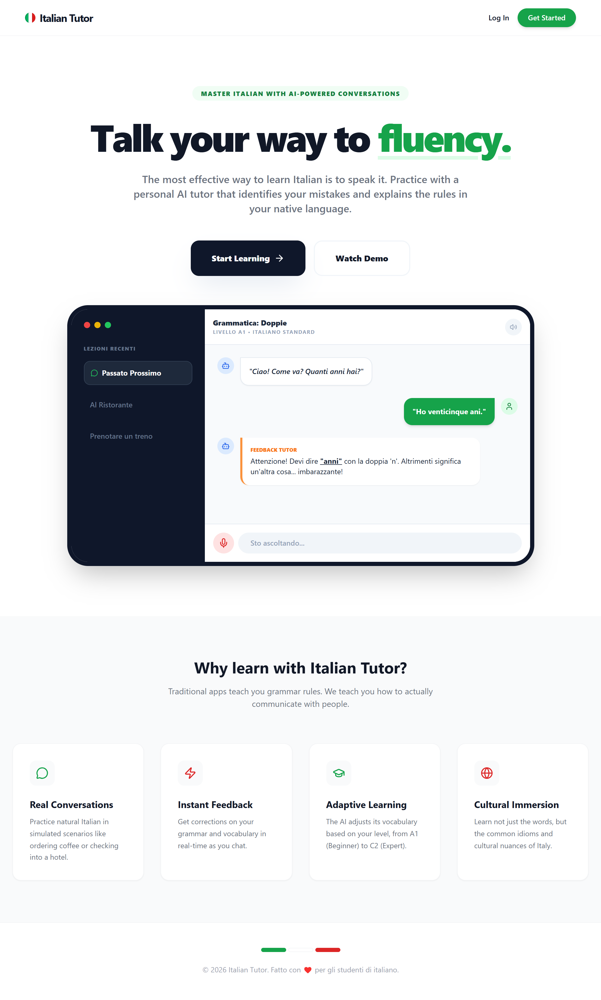
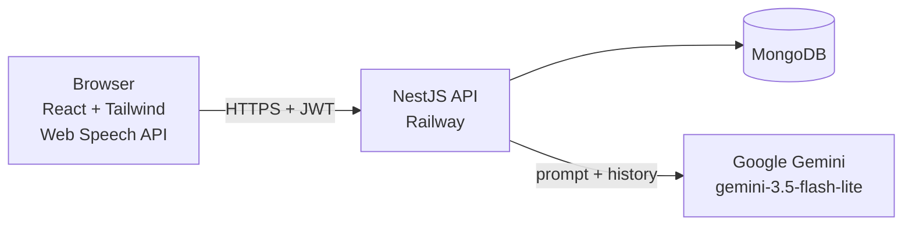

# AI Italian Tutor 🇮🇹

Practice Italian by chatting with an AI tutor. Pick your level (A1–C2), choose a grammar point (e.g. *Passato Prossimo*) or a real-world topic (e.g. *Ordering coffee*), and the tutor replies in Italian and explains your mistakes in your own language. You can talk to it and hear it speak back.

**Live demo:** https://ai-italian-tutor.vercel.app/



## Features

- **Accounts:** sign up and log in with JWT authentication.
- **Customisable practice:** level (A1–C2), mode (grammar or topic) and a focus area.
- **AI tutor:** replies in Italian, gently corrects mistakes, and explains the corrections in your support language. It only helps with learning Italian and politely refuses anything else.
- **Voice:** speak your messages and listen to the tutor's replies (Web Speech API, Chrome and Edge).
- **Conversation history:** sessions and messages are saved, so you can come back to them.
- **Multi-language UI:** English, French, Spanish, Portuguese, Italian, Ukrainian and Arabic.
- **Free trial + bring your own key:** every account gets 5 free AI calls. After that, save your own Google Gemini key for unlimited use.

## Tech stack

| Part | Tech | Hosted on |
|---|---|---|
| Frontend | React 19 (Vite, JavaScript), Tailwind CSS 3, Axios | Vercel |
| Backend | NestJS 11 (TypeScript), Passport + JWT | Railway |
| Database | MongoDB (Mongoose) | — |
| AI | Google Gemini `gemini-3.5-flash-lite` via `@google/genai` | — |
| Voice | Web Speech API (in the browser) | — |

## Architecture



**How a message flows**

1. The user types or speaks a message (speech is converted to text in the browser).
2. The client sends `POST /chat/send-message` with the session id and the message, plus the JWT.
3. The server checks the token, the rate limit, the request body, that the session belongs to the user, and the free-call quota.
4. It loads the latest 20 messages, builds the system prompt (level, focus area, support language) and calls Gemini, using the user's own key if they saved one, otherwise the app key.
5. On success it saves both messages, counts one free call (app key only) and returns the reply.
6. On failure it returns a 502/503 (or 400 if the user's own key is rejected). Nothing is saved or counted, and the client offers a retry.

**Built with production concerns in mind**

- Every request body is validated with a DTO; every session and message route checks ownership.
- Global rate limiting, with stricter limits on auth and AI routes.
- Free-tier quota enforced on the server, so the app can run on the free Gemini tier without costs.
- Users' saved Gemini keys are encrypted at rest (AES-256-CBC) and never returned.
- Failed AI calls are never saved or counted, and have a timeout and one retry.

## Project structure

```
client/    React app (Vite)
server/    NestJS API
shared/    constants.json: free-call limit, levels, modes, support languages (used by both sides)
docs/      project overview, progress tracker, audit report
```

## Getting started

### Prerequisites

- Node.js 22 or newer
- A MongoDB database (local or [MongoDB Atlas](https://www.mongodb.com/atlas))
- A Google Gemini API key from [Google AI Studio](https://aistudio.google.com/apikey)

### 1. Backend

```bash
cd server
npm install
cp .env.example .env     # then fill in the values (see the table below)
npm run start:dev
```

The API runs on http://localhost:3000. Check it with `GET /health`.

### 2. Frontend

```bash
cd client
npm install
cp .env.example .env     # optional: the default API URL is http://localhost:3000
npm run dev
```

The app runs on http://localhost:5173.

### Environment variables

**Server** (`server/.env`)

| Variable | Required | Purpose |
|---|---|---|
| `PORT` | no | API port (default `3000`) |
| `DB_URL` | yes | MongoDB connection string (falls back to a local database) |
| `JWT_SECRET` | yes | Secret used to sign login tokens |
| `GOOGLE_API_KEY` | yes | App-wide Gemini key, used for the free tier |
| `ENCRYPTION_KEY` | yes | 64-character hex key used to encrypt users' saved Gemini keys. Generate one with `node -e "console.log(require('crypto').randomBytes(32).toString('hex'))"` |
| `FRONTEND_URL` | yes | Allowed CORS origin (e.g. `http://localhost:5173`) |

**Client** (`client/.env`)

| Variable | Required | Purpose |
|---|---|---|
| `VITE_API_URL` | no | Backend base URL (default `http://localhost:3000`) |

Never commit `.env` files.

### Scripts

| Where | Command | What it does |
|---|---|---|
| `server/` | `npm run start:dev` | Dev server with reload |
| `server/` | `npm test` / `npm run test:e2e` | Unit / end-to-end tests |
| `server/` | `npm run lint` / `npm run lint:fix` | Check / auto-fix lint issues |
| `server/` | `npm run build` | Production build |
| `client/` | `npm run dev` | Vite dev server |
| `client/` | `npm run lint` / `npm run build` | Lint / production build |

## API

All `/chat` and `/users` routes need an `Authorization: Bearer <token>` header.

| Method | Route | Purpose |
|---|---|---|
| POST | `/auth/signup` | Create an account |
| POST | `/auth/login` | Log in and get a JWT |
| POST | `/chat/start-session` | Start a session; the tutor sends an opening message |
| GET | `/chat/sessions` | List your sessions |
| GET | `/chat/sessions/:id/messages` | Get a session's messages (owner only) |
| POST | `/chat/send-message` | Send a message and get the tutor's reply |
| DELETE | `/chat/sessions/:id` | Delete a session and its messages (owner only) |
| PUT | `/users/api-key` | Save your own Gemini key (checked with Gemini first) |
| PUT | `/users/language` | Change your support language |
| GET | `/health` | Health check (no auth, not rate-limited) |

Rate limits are per IP: 5 signups, 10 logins, 5 new sessions and 15 messages per minute; 60 per minute for everything else.

## Deployment

- **Frontend (Vercel):** root directory `client/`. `client/vercel.json` rewrites all routes to `index.html` so deep links work. Set `VITE_API_URL` to the Railway URL. Because the client imports `shared/constants.json`, enable "Include source files outside of the Root Directory" in the Vercel project settings.
- **Backend (Railway):** the service builds from the **repository root** (not `server/`), because the server imports `shared/`. The root `package.json` runs the server build, and `railway.json` sets the start command (`cd server && npm run start:prod`) and the `/health` health check. Set the server environment variables listed above.

## Limitations

- Voice input and output work in Chrome and Edge only; the mic is hidden in unsupported browsers.
- The free tier is deliberately small (5 AI calls per account) to avoid API costs.
- Email verification is not implemented yet.

## Roadmap

- Structured tutor replies with highlighted corrections
- Streaming replies
- End-of-session summary by grammar topic
- Email verification

## License

[MIT](LICENSE) © 2026 Maye Jesuorobo
